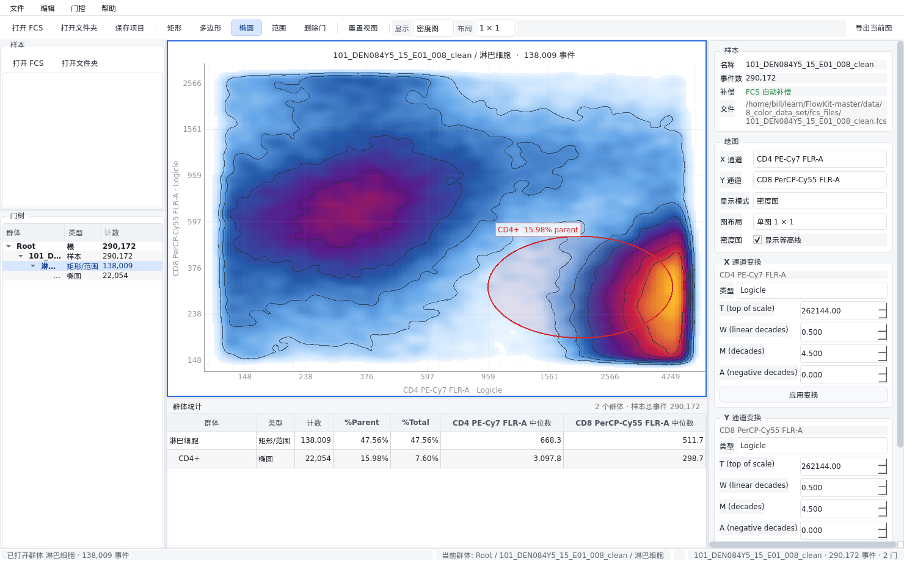

# CytoDesk

CytoDesk 是一个类似 FlowJo 的桌面流式细胞数据分析软件。界面使用
PySide6 + pyqtgraph，分析内核使用 [FlowKit](https://github.com/whitews/flowkit)。

当前版本为 **0.1.0（单样本手动分析 MVP）**。



## 已实现功能

- 读取 FCS 2.0 / 3.0 / 3.1 文件；对偏移异常的文件提供兼容模式重试
- 自动应用 FCS 内嵌 `$SPILLOVER` / `$SPILL` 补偿矩阵（可通过 `load_sample_file(auto_compensate=False)` 关闭）
- 样本工作区：打开文件、打开文件夹、拖放文件、移除样本
- 通道选择与显示名称（PnS / PnN）
- 每通道默认变换：
  - 散射/时间通道：Linear
  - 荧光通道：Logicle（T 取自 FCS 的 PnR）
- 变换编辑器：Logicle、Linear、Asinh、Log、Hyperlog 参数调整
- 三种绘图模式：
  - 散点图（自动抽稀，保持交互流畅）
  - 密度图（平滑二维密度 + 对数伪彩，可显示等高线）
  - 直方图（单通道分布）
- 散点图与密度图使用同一批显示事件（最多 30 万），保证两种模式的结构一致
- 切换显示模式时清除选中门的事件点高亮；密度图不叠加散点高亮
- 1 × 1 / 2 × 2 图布局，最多四个独立坐标轴面板
- 手动门控：
  - 默认椭圆圈门；直方图模式下默认范围门
  - 矩形门
  - 多边形门（单击加点，双击/右键结束）
  - 椭圆门
  - 一维范围门
- 门树层级：Root → 原始 FCS 样本 → 门 → 子门
- 打开群体：
  - 在门树中双击门，或在绘图区双击门，或右键门选择“打开此门并圈门”
  - 只显示该门内的事件，并使用该群体的事件重新计算坐标范围
  - 当前群体在门树中加粗，标题和状态栏显示群体路径
  - 点击门树的 Root 或原始 FCS 样本节点可返回全样本视图
- 子门创建：
  - 打开一个门后，直接在重缩放后的视图中绘制，新门自动成为该群体的子门
  - 也可在门树右键、在中央绘图区右键门，选择“打开此门并圈门”
- 门编辑：
  - 在门内部或边框上拖动即可整体移动门
  - 选中门后拖动控制点可调整形状
  - 按住 `Shift` 拖动可在已有门内部绘制新的门
  - 门树重命名、删除、层级展示
  - 门颜色自定义
  - 图上门标签显示 `% parent`（占父门比例），而不是事件计数
- 群体统计：
  - Count、%Parent、%Total（始终基于全部事件，不使用显示抽稀）
  - 当前 X/Y 通道的中位数（反变换回原始荧光值显示）
  - 点击统计行联动门树与图形
- 项目保存/打开 `.cytodesk`（zip + JSON，保存样本路径、门、变换、颜色、等高线设置和绘图布局）
- 统计 CSV 导出
- 当前图 PNG / SVG 导出

## 环境要求

- Python 3.10+
- Linux 桌面环境（当前主要在 Linux 下开发）
- 依赖由 `uv` 管理

FlowKit 从 PyPI 安装，版本范围写在 `pyproject.toml`：

```toml
dependencies = ["flowkit>=1.3.2,<1.4"]
```

如需在本地修改 FlowKit 并调试，可以临时改为 editable 安装：

```bash
uv add --editable ../FlowKit-master
```

## 快速开始

```bash
cd ~/learn/cytodesk
uv sync
uv run cytodesk
```

也可以直接打开一个或多个 FCS 文件：

```bash
uv run cytodesk /path/to/sample.fcs
```

## 基本工作流

1. 点击 **打开 FCS**，或把 `.fcs` 文件拖入窗口。
2. 在右侧 **绘图** 区域选择 X / Y 通道。
3. 在 **显示模式** 中选择散点图、密度图或直方图。
4. 如需调整坐标，在 **X/Y 通道变换** 中修改参数并点击 **应用变换**。
5. 工具栏默认处于椭圆圈门模式（直方图为范围门模式），直接在图上拖拽绘制。
   - 新门默认与当前群体同级。
   - 状态栏右下角显示“当前群体: Root / 样本名 / …”。
   - 要进入某个群体继续圈门，双击门树中的门，或在绘图区双击/右键单击门，选择“打开此门并圈门”。视图会只保留该门内事件并重新缩放。
   - 点击门树的 Root 或样本节点返回全样本视图。
6. 在下方统计表中查看群体 count、百分比和中位数。
7. 密度图模式下可在右侧勾选“显示等高线”。
8. 使用 **保存项目** 保存为 `.cytodesk`，或从 **文件** 菜单导出统计/图像。

## 常用快捷键

| 快捷键 | 功能 |
| --- | --- |
| `Ctrl+O` | 打开 FCS |
| `Ctrl+Shift+O` | 打开文件夹 |
| `Ctrl+Alt+O` | 打开项目 |
| `Ctrl+S` | 保存项目 |
| `Ctrl+Shift+S` | 项目另存为 |
| `Ctrl+E` | 导出当前图 |
| `Ctrl+Shift+E` | 导出统计 CSV |
| `Ctrl+1` … `Ctrl+4` | 矩形 / 多边形 / 椭圆 / 范围工具 |
| `Ctrl+Delete` | 删除选中的门 |
| `Ctrl+0` | 重置视图 |
| `Esc` | 取消正在绘制的门并回到默认圈门工具 |

## 项目结构

```
src/cytodesk/
├── app.py                 # QApplication、主题、入口
├── core/
│   ├── channels.py        # FCS 通道元数据
│   ├── transforms.py      # 序列化变换 + 默认参数
│   ├── gates.py           # 门创建、序列化、几何变换
│   ├── session.py         # 样本/门控/统计核心
│   └── project.py         # .cytodesk 保存与加载
├── plotting/
│   ├── plot_panel.py      # 散点/密度/直方图、门绘制与编辑
│   └── plot_grid.py       # 1×1 / 2×2 布局
└── ui/
    ├── main_window.py     # 主窗口与流程编排
    ├── sample_panel.py    # 样本列表
    ├── gate_tree.py       # 门树
    ├── stats_table.py     # 群体统计表
    ├── inspector.py       # 通道/变换/门属性
    └── labels.py          # 界面文案映射
```

## 常见问题

如果启动时报错：

```
Could not load the Qt platform plugin "xcb"
```

说明系统缺少 XCB 运行库。可安装：

```bash
sudo apt install libxcb-cursor0
```

或在 Wayland 会话中使用默认的 Wayland 平台插件启动（本程序在 Wayland 下可直接运行）。

## 测试

```bash
uv run pytest
```

测试数据仍来自本地 FlowKit 仓库的 `data` 目录（默认 `../FlowKit-master/data`），但运行和打包不依赖该仓库。测试覆盖：

- FCS 加载与通道识别
- 变换正反算
- 矩形/多边形门的门控与统计
- 门的重命名/删除
- 椭圆/矩形/范围门几何操作
- `.cytodesk` 保存/加载往返
- Qt 界面冒烟测试
- 鼠标拖拽绘制矩形门及门父级逻辑
- 直方图模式

## 打包 Windows / macOS

使用 PyInstaller + GitHub Actions。PyInstaller 不能交叉编译，Windows 包在
Windows runner 上构建，macOS 包在 macOS runner 上构建。

本地构建：

```bash
uv sync --group build
uv run pyinstaller packaging/cytodesk.spec --noconfirm --clean
```

产物：

- Windows：`dist/CytoDesk/CytoDesk.exe`
- macOS：`dist/CytoDesk.app`

推送 `v*` 标签会触发 `.github/workflows/build.yml` 自动构建并发布 GitHub Release。
详细说明见 `packaging/README.md`。

## 当前限制 / 后续计划

0.1.0 聚焦单样本手动分析。以下功能在后续版本实现：

- 补偿矩阵编辑器（FCS `$SPILL`、CSV/TSV、手动矩阵）
- 多样本批量门控、跨样本统计与叠加显示
- FlowJo `.wsp` 导入、GatingML 导入/导出
- FCS / CSV 数据导出
- 撤销/重做
- Windows/macOS 正式代码签名与公证
- 更丰富的统计（CV、分位数、群体比较）与出版级图导出
